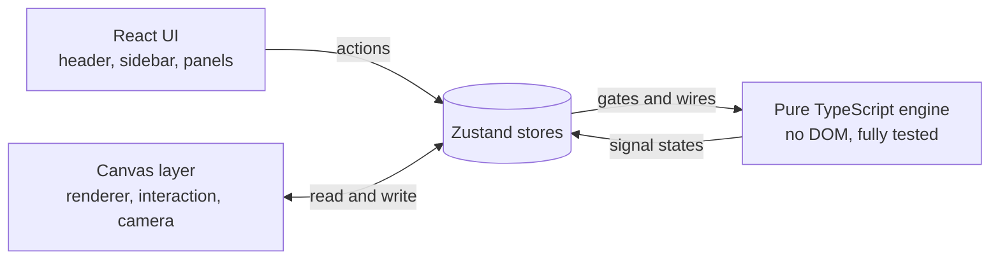
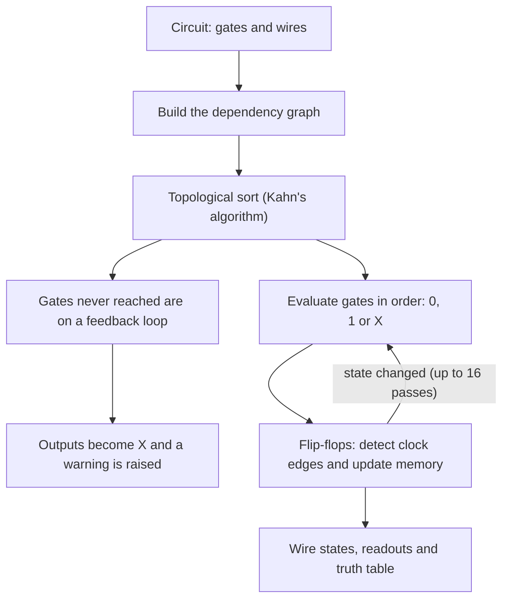

<div align="center">

<h1>
  <picture>
    <source media="(prefers-color-scheme: dark)" srcset="docs/axiomlab-wordmark-dark.svg">
    
  </picture>
</h1>

### Build logic. Watch it come alive.

A digital logic simulator that runs entirely in your browser.<br/>
Drag gates onto a canvas, wire them together, and watch every signal travel.

**[Open the live demo](https://bhbaxiomlab.vercel.app/)**&nbsp;&nbsp;·&nbsp;&nbsp;[Report a bug](https://github.com/bayharborbytcher/AxiomLab/issues/new?labels=bug)&nbsp;&nbsp;·&nbsp;&nbsp;[Request a feature](https://github.com/bayharborbytcher/AxiomLab/issues/new?labels=enhancement)

<br/>


[](LICENSE)


</div>

<!--
  Add a screenshot or a short screen recording here. It is the single best thing you can do for this page.
  A full-window capture of the full adder running in Operate mode works well. Save it as docs/hero.png, then uncomment:

  <p align="center"></p>
-->

---

## What is AxiomLab?

Most logic simulators feel like lab software. **AxiomLab is built to feel like a native Apple app** (calm, glassy and springy) while being a real simulator underneath.

Place AND, OR, XOR and friends on a large, free-panning canvas. Wire them with clean right-angled lines. Flip a switch and watch a pulse of light race down the wire, through the gates, and into the output. Run a clock and watch a flip-flop count. Then open the truth table and see AxiomLab work out the **simplest Boolean expression** for your circuit on its own.

It is made for students learning digital electronics, teachers who want something better than a whiteboard, and anyone who simply enjoys watching logic work.

---

## Highlights

| | |
|---|---|
| **Real signals, not decoration** <br/> Three-valued logic (`0`, `1` and undefined `X`) with topological evaluation, so a circuit behaves the way the textbook says it should. | **Light that travels** <br/> When a wire turns on, the glow runs from the output pin to the input pin at constant speed. When it turns off, it retreats the same way. |
| **Memory and time** <br/> SR latches, D, JK and T flip-flops, and a clock you can run, pause and step, from 0.5 to 8 Hz. Feedback through memory just works. | **It does the algebra for you** <br/> A live truth table and a simplified sum-of-products expression, derived with the Quine-McCluskey algorithm, complete with proper overbars. |
| **Made to be touched** <br/> Liquid Glass capsules, spring physics that never overshoot, tooltips with shortcuts, and a loading page with its own personality. | **Safe to experiment** <br/> 100 steps of undo and redo, a collision-free canvas, and a separate **Operate** mode so you can flip switches without moving a single gate. |

---

## Try it in a minute

1. Open the **[live demo](https://bhbaxiomlab.vercel.app/)**.
2. In the sidebar, open **Examples** and pick **Full adder**.
3. Switch the header toggle from **Edit** to **Operate**.
4. Click the input switches. Watch the glow travel and the **Sum** and **Cout** readouts change.
5. Look at the right panel: every row of the truth table, the current row highlighted, and the simplified expression underneath. Click any row to set the switches to it.
6. Back in **Edit** mode, drag a gate in from the sidebar and wire your own circuit. Press <kbd>Ctrl</kbd> <kbd>Z</kbd> whenever you like.

---

## Features

<details open>
<summary><b>The canvas</b></summary>

<br/>

- A dot-grid workspace with smooth, **spring-driven pan and zoom**. Zoom stays anchored under your cursor, from 25% to 400%.
- A **minimap**, and one-tap **Origin** and **Fit circuit** buttons that glide the view where you need it.
- Rendering is snapped to whole device pixels, so lines and dots stay crisp on any screen.
- Gates snap to the grid, can never overlap, and can never leave the workspace. Drop one on top of another and it finds the nearest free spot.

</details>

<details>
<summary><b>Gates and parts (16 types)</b></summary>

<br/>

| Group | Parts |
|---|---|
| **Logic** | `AND` `OR` `NOT` `NAND` `NOR` `XOR` `XNOR` `BUFFER`, drawn with IEEE-style symbols |
| **Input and output** | `INPUT` toggle switch, `OUTPUT` readout (`0`, `1` or `X`), `CLOCK`, `LED` |
| **Memory** | `SR latch`, `D flip-flop`, `JK flip-flop`, `T flip-flop` |

Select any gate and an info card appears at the top right of the canvas describing what it does. Selecting a clock lets you set its frequency.

</details>

<details>
<summary><b>Wires</b></summary>

<br/>

- Drag from any pin to another, or click a pin and then click the target. Wires route themselves with right angles and rounded corners, and re-route as you move gates.
- Each input accepts one wire, and connecting to an input that already has one replaces it. Outputs can fan out to as many inputs as you like.
- Every wire gets its own colour from a palette of 12, chosen to stay readable on a dark canvas, so crossing wires never blur together.

| What you see | What it means |
|---|---|
| Dim wire | Logic `0` |
| Bright, glowing wire | Logic `1` |
| Dashed orange wire | Undefined (`X`) |
| The wire's own colour | Only identity, never state |

</details>

<details>
<summary><b>Simulation</b></summary>

<br/>

- The circuit is re-evaluated on every change. No run button is needed for combinational logic.
- **Operate mode** locks editing so you can toggle switches and clocks safely.
- **Run, Pause and Step** control the clocks. Step flips every clock once (half a cycle) so you can watch a flip-flop capture a value edge by edge.
- Feedback loops built from plain gates are detected, drawn with an orange dashed ring, and reported in a banner, instead of freezing the app.

</details>

<details>
<summary><b>Truth table and Boolean algebra</b></summary>

<br/>

- Up to **4 inputs**, the table builds itself and follows the circuit live. From **5 to 8 inputs** (up to 256 rows) you generate it on request.
- Inputs are named `A`, `B`, `C`… and outputs `Y` (`Y1`, `Y2`… when there are several) from top to bottom on the canvas. The same names appear above each switch and readout.
- The row matching your switches is highlighted. Click any row to set the switches to that combination.
- A **simplified sum-of-products expression** is derived for every output, with overbars for complemented variables.
- Copy the table to your clipboard (spreadsheet-ready) or download it as CSV.
- Circuits with a clock or memory have no truth table, because their outputs depend on history. AxiomLab tells you so rather than showing a wrong one.

</details>

<details>
<summary><b>Editing, history and files</b></summary>

<br/>

- **Undo and redo** with 100 steps, built on the command pattern.
- Multi-select, move, duplicate (with the wires between the gates), and a **right-click menu** for gates, wires and the canvas.
- **Save** a circuit as a versioned JSON file and **open** it later. Files are validated on open, so a damaged file gives a clear message instead of a crash.
- **Export** a clean PNG of just the circuit.
- Six built-in examples: half adder, full adder, 4-bit adder, 2-to-1 multiplexer, SR latch and D flip-flop.

> Circuits are not auto-saved yet. Press <kbd>Ctrl</kbd> <kbd>S</kbd> to keep your work.

</details>

---

## The design

AxiomLab follows Apple's Human Interface Guidelines and the Liquid Glass design language, brought to the web.

- **Liquid Glass controls.** Translucent, blurred capsules with a bright top edge float above the canvas. Related actions share one glass group, and glass is never stacked on glass.
- **Springs, not tweens.** Motion runs on critically damped springs wherever it matters, so it starts gently, never bounces, and can be interrupted at any moment. The sidebar, panels, mode switch, zoom, the camera and the truth-table pointer all share the same physics.
- **Motion with meaning.** Switching to Operate sends a soft shadow rising up the gate palette, and switching back lets it drain away. In the truth table, a pointer glides to the row your switches match, and new rows blur into place when you add an input.
- **Direct manipulation.** Buttons respond the instant you press them. Dragged gates track your pointer one to one.
- **Type.** The interface uses the Apple system font stack, which is SF Pro on Apple devices and Inter everywhere else.
- **Accessibility.** Every icon button has a label and a tooltip. Reduced-motion and reduced-transparency preferences are respected. Focus is visible.
- **A loading page with character.** An animated orb, status messages that change as the app starts up, and a handoff where the author's GitHub avatar rides the curtain up into the header.

---

## Under the hood

AxiomLab keeps three layers apart, which keeps the code easy to test and easy to extend.



### How a circuit is evaluated



A few details worth knowing:

- **Three-valued logic.** An unknown input only spoils the result when it could change it.

  | Inputs | AND | OR | XOR |
  |---|:---:|:---:|:---:|
  | `0`, `X` | `0` | `X` | `X` |
  | `1`, `X` | `X` | `1` | `X` |
  | `X`, `X` | `X` | `X` | `X` |

- **Floating inputs are undefined.** A forgotten wire shows up as `X` instead of quietly counting as `0`.
- **Memory parts are sources.** Their outputs come from stored state, so a counter that feeds a flip-flop's output back into itself is not mistaken for a loop. Ripple counters settle over several passes.
- **Edge detection.** Flip-flops compare the clock level before and after each pass to find real rising edges.

### Tech stack

| Area | Choice | Why |
|---|---|---|
| UI | **React 18** | Small, isolated panels that re-render independently |
| Drawing | **HTML Canvas 2D** | Full pixel control, with no DOM node per gate or wire |
| Language | **TypeScript** | Gates, pins and wires are strictly typed, so wiring bugs surface at compile time |
| Build | **Vite** | Instant dev server and a lean static production build |
| Styling | **Tailwind CSS v4** | A themeable dark palette and a small glass design system |
| State | **Zustand** | Stores readable from React *and* from the canvas renderer |
| Motion | **Framer Motion**, **Lenis** | Spring physics, layout animation and smooth scrolling |
| Loader orb | **thinking-orbs** | The animated orb on the loading page |
| Tests | **Vitest** | Headless tests for the logic engine, run in Node |

There is no backend and no account. Everything runs in your browser.

### Project structure

```
AxiomLab/
├── index.html
├── vite.config.ts
├── public/
└── src/
    ├── types/        gate, wire and circuit types
    ├── engine/       pure TypeScript logic (no DOM)
    │   ├── gates.ts          truth functions and the 16 part definitions
    │   ├── evaluator.ts      topological sort, loop detection, flip-flop memory
    │   ├── truthTable.ts     table generation, CSV and clipboard text
    │   ├── booleanExpr.ts    Quine-McCluskey simplification
    │   ├── history.ts        command-pattern undo and redo
    │   └── circuitFile.ts    file validation and example circuits
    ├── canvas/       rendering and interaction
    │   ├── renderer.ts       gates, wires, glow, grid
    │   ├── gateShapes.ts     IEEE-style shapes and pin positions
    │   ├── wireRouting.ts    right-angle routing
    │   ├── hitTest.ts        selection, pins, collisions, workspace bounds
    │   ├── interaction.ts    pointer, wheel and keyboard handling
    │   ├── camera.ts         spring-driven pan and zoom
    │   ├── canvasManager.ts  the bridge between React and the canvas
    │   └── exportImage.ts    PNG export
    ├── store/        Zustand stores: circuit, selection, simulation, history, ui
    ├── components/   Header, Sidebar, Canvas, TruthTable, Loading, shared
    ├── hooks/        keyboard, simulation, truth table and boot hooks
    ├── lib/          file helpers and site constants
    ├── presets/      built-in example circuits (.json)
    └── tests/        engine unit tests
```

---

## Controls

| Action | How |
|---|---|
| Pan | Hold <kbd>Space</kbd> and drag, use the middle mouse button, or just scroll |
| Zoom | <kbd>Ctrl</kbd> + scroll, anchored at the cursor |
| Place a gate | Drag it from the sidebar onto the canvas |
| Wire | Drag from one pin to another, or click one pin then the other |
| Move | Drag a gate. Hold <kbd>M</kbd> for a more forgiving grab |
| Multi-select | <kbd>Shift</kbd> + click, or <kbd>Ctrl</kbd> <kbd>A</kbd> |
| Duplicate | <kbd>Ctrl</kbd> <kbd>D</kbd> |
| Remove | <kbd>Del</kbd> or <kbd>Backspace</kbd> |
| Undo and redo | <kbd>Ctrl</kbd> <kbd>Z</kbd> and <kbd>Ctrl</kbd> <kbd>Y</kbd> (or <kbd>Ctrl</kbd> <kbd>Shift</kbd> <kbd>Z</kbd>) |
| Save and open | <kbd>Ctrl</kbd> <kbd>S</kbd> and <kbd>Ctrl</kbd> <kbd>O</kbd> |
| Cancel | <kbd>Esc</kbd> cancels a wire in progress, then clears the selection |
| Context menu | Right-click a gate, a wire or the canvas |

On a Mac, use <kbd>Cmd</kbd> in place of <kbd>Ctrl</kbd>.

---

## Getting started

You need **Node.js 20.19+ or 22.12+** (the current LTS is a safe choice).

```bash
# 1. Clone
git clone https://github.com/bayharborbytcher/AxiomLab.git
cd AxiomLab

# 2. Install
npm install

# 3. Run the dev server
npm run dev
```

Then open **http://localhost:5173**.

| Command | What it does |
|---|---|
| `npm run dev` | Start the dev server with hot reload |
| `npm run build` | Type-check and create a production build in `dist/` |
| `npm run preview` | Serve the production build locally |
| `npx vitest run` | Run the engine test suite once |
| `npm test` | Run the tests in watch mode |

### Tests

The logic engine is pure TypeScript with no DOM, so it is tested headlessly. The suite covers gate truth tables, topological evaluation, loop detection, flip-flop edge behaviour, undo history, truth tables, Boolean simplification, and file validation. It also checks that every built-in example does what it claims, including a 4-bit adder tested against every pair of 4-bit numbers.

### Deploying

AxiomLab is a static site, so any static host works. The project builds with a relative base path, so it works from a domain root (Vercel, Netlify, Cloudflare Pages) and from a sub-path (GitHub Pages) without changes. The live demo runs on Vercel: import the repo and click **Deploy**, and the Vite settings are detected automatically.

---

## Roadmap

Ideas for where AxiomLab could go next. Contributions and suggestions are welcome.

- [ ] Karnaugh map view that matches the truth table
- [ ] Propagation-delay animation, to watch a signal pass through gates one at a time
- [ ] Autosave to the browser
- [ ] Bus wires for multi-bit signals
- [ ] Sub-circuits: package a circuit as a reusable part
- [ ] Share a circuit through a link
- [ ] Gate rotation
- [ ] A touch-friendly layout (AxiomLab is desktop-first today)

---

## How it was built

AxiomLab is a **human-directed, AI-assisted** project. The idea, the product decisions, the interaction design, the visual direction and every round of testing and feedback came from the author. The code was pair-programmed with **[Claude](https://www.anthropic.com/claude)**, Anthropic's AI assistant, which proposed architecture, wrote and refined the implementation, and checked the logic engine against its test suite.

The result is a deliberate collaboration: a person with a clear picture of what the product should feel like, and an assistant fast enough to chase every detail of it.

---

## Contributing

Issues and pull requests are welcome. If you plan a larger change, please open an issue first so we can talk it through. Before sending a pull request, run `npm run build` and `npx vitest run`.

## License

Released under the **MIT License**. See [`LICENSE`](LICENSE).

## Credits

- The loading-page orb is **[thinking-orbs](https://libraries.dev/orbs)** by Jakub Antalik.
- Motion by **[Framer Motion](https://motion.dev/)**, smooth scrolling by **[Lenis](https://lenis.darkroom.engineering/)**, state by **[Zustand](https://zustand.docs.pmnd.rs/)**.
- Fallback typeface: **[Inter](https://rsms.me/inter/)** by Rasmus Andersson.
- Design inspiration from Apple's [Human Interface Guidelines](https://developer.apple.com/design/human-interface-guidelines/). AxiomLab is an independent project and is not affiliated with or endorsed by Apple Inc. Apple and SF Pro are trademarks of Apple Inc.

<div align="center">

<br/>

Made by [**bayharborbytcher**](https://github.com/bayharborbytcher)

If AxiomLab helped you learn something, a star on the repo means a lot.

</div>
